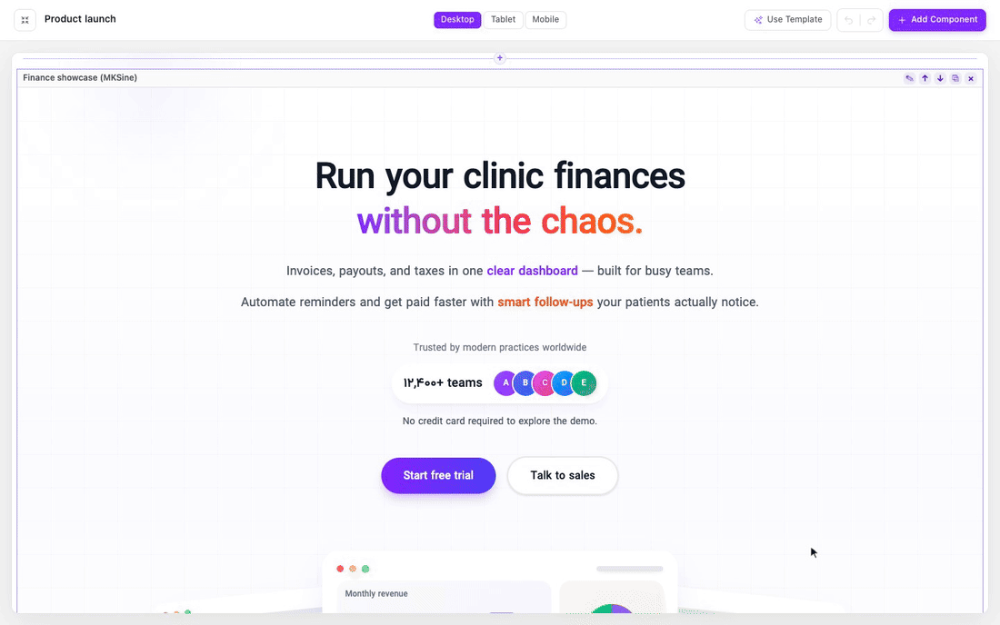
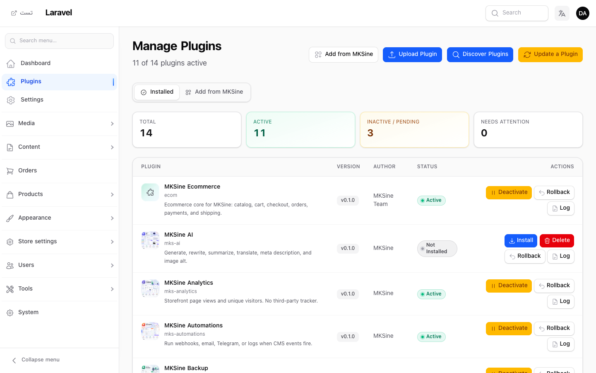
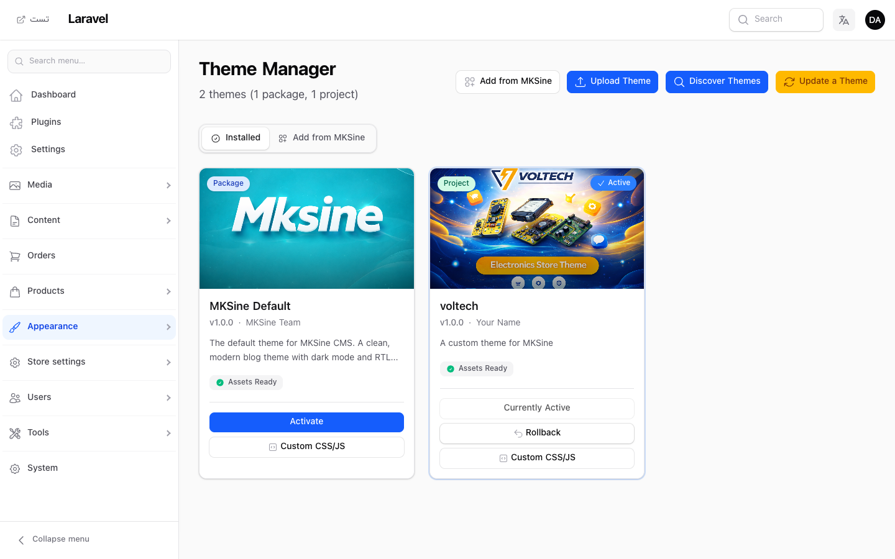
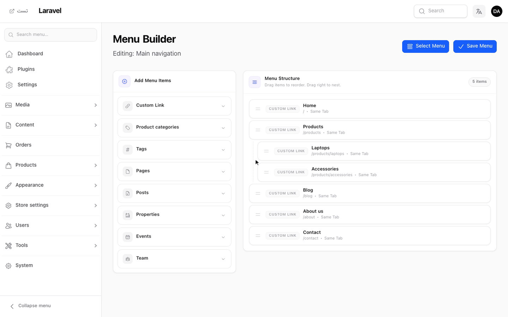
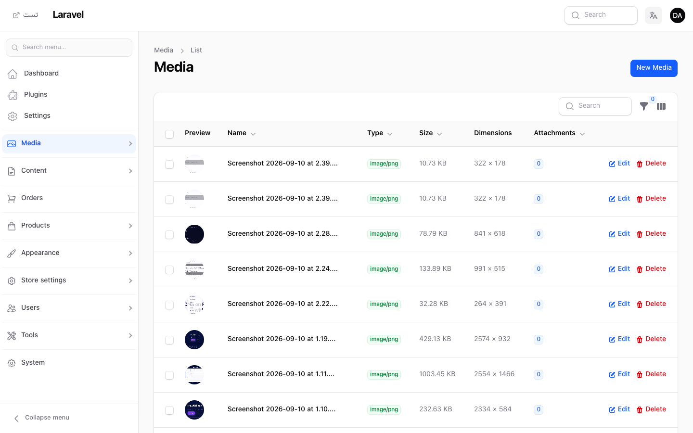
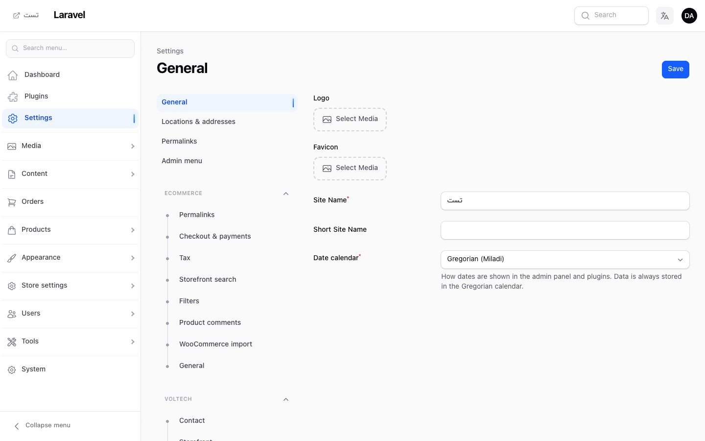
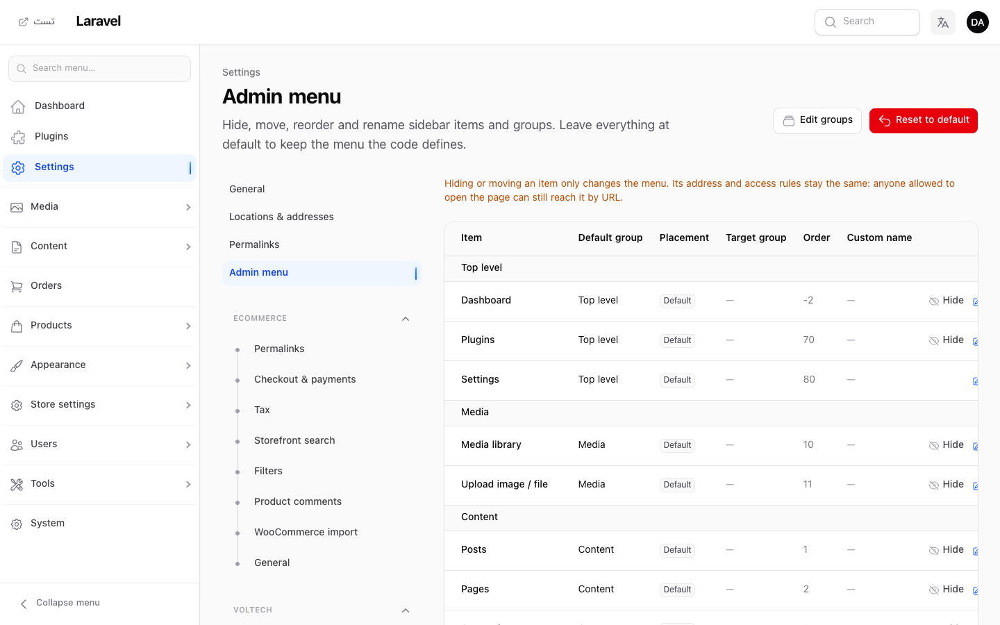
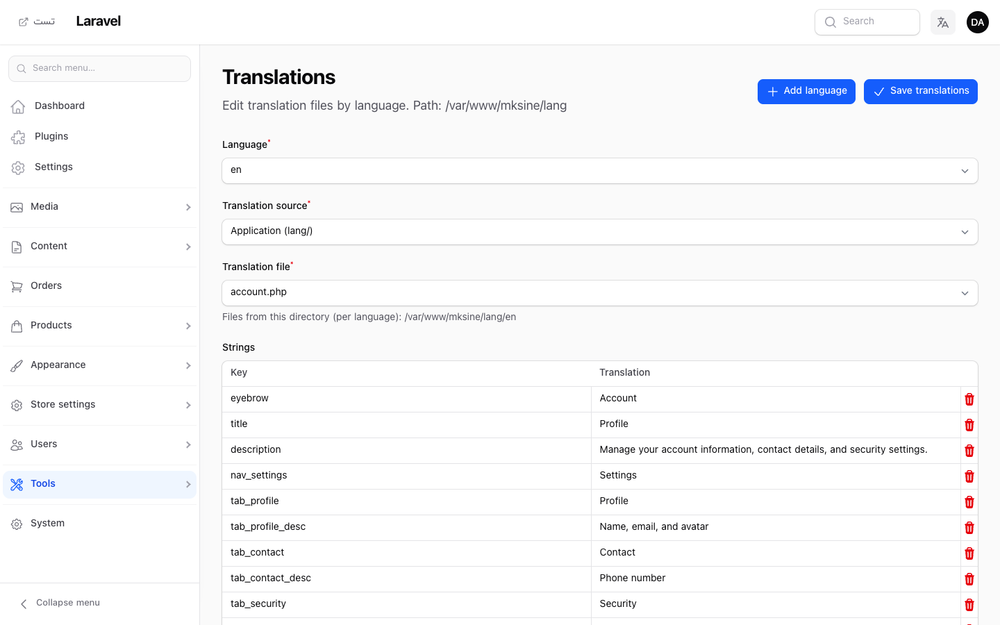
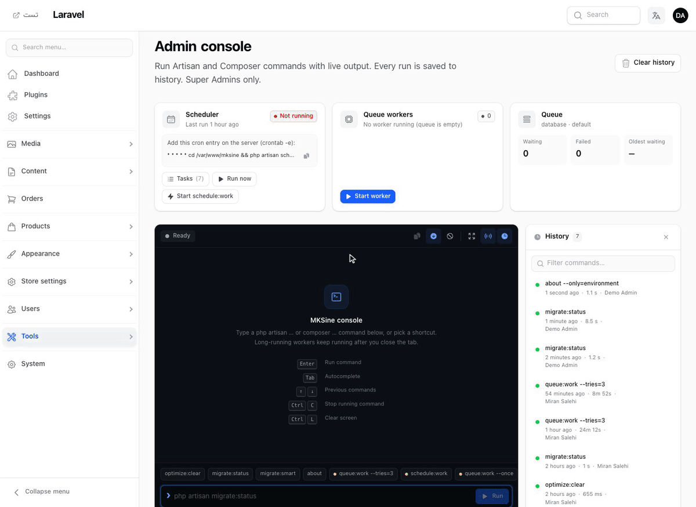

<div align="center">

# MKSine

**The Laravel + Filament 4 / 5 CMS foundation — build content sites, page builders, and plugin ecosystems without fighting your admin panel.**



[](https://packagist.org/packages/miran/mksine)
[](https://packagist.org/packages/miran/mksine)
[](LICENSE)

[Quick Install](#quick-install) · [Features](#features) · [Documentation](https://github.com/MiranSalehi/mksine/tree/main/docs)

</div>

---

## Why MKSine

Filament gives you a great admin panel. MKSine gives you the **CMS layer on top of it**: content types, a visual page builder, installable plugins with real lifecycle management, themes, menus, hooks, and a settings system — all built the Filament way, so it feels native instead of bolted on.

If you've ever built a "simple site" in Laravel and ended up hand-rolling pages, blocks, menus, and a plugin system from scratch — this is that groundwork, already done.

---

## Quick install

```bash
composer require miran/mksine
php artisan filament:install --panels
# Register MksinePlugin in AdminPanelProvider (remove default Dashboard page)
# Remove Route::get('/', …) from routes/web.php (MKSine owns the homepage)
php artisan mksine:install --migrate
php artisan mksine:create-super-admin
```

Full installation guide → [docs/01-installation.md](https://github.com/MiranSalehi/mksine/blob/main/docs/01-installation.md)

---

## Features

### 🧱 Page Builder

Opt-in visual block editor for marketing pages. Compose typed blocks (hero, columns, cards, CTA, theme sections, and more), edit them in a side panel and see the canvas update live, preview on desktop, tablet, and mobile, and start from templates. Undo/redo and page revisions are built in. The tree is stored as JSON, rendered by the active theme, and also available as a JSON document API for headless front ends.

📖 [Concepts](https://github.com/MiranSalehi/mksine/blob/main/docs/concepts/page-builder.md) · [Creating a block](https://github.com/MiranSalehi/mksine/blob/main/docs/guides/page-builder/creating-a-block.md) · [Rendering](https://github.com/MiranSalehi/mksine/blob/main/docs/guides/page-builder/rendering.md) · [Headless JSON](https://github.com/MiranSalehi/mksine/blob/main/docs/guides/page-builder/headless.md)

---

### 🧩 Plugins

Drop-in extensions under `plugins/{id}/` with full lifecycle — install, activate, deactivate, roll back — from a ZIP upload, filesystem discovery, or the MKSine marketplace. Filament autoloading, migrations, assets, and hook listeners are handled for you, and every action is logged. No forking core to extend the system.



📖 [Concepts](https://github.com/MiranSalehi/mksine/blob/main/docs/concepts/plugins.md) · [Build a plugin (golden path)](https://github.com/MiranSalehi/mksine/blob/main/docs/guides/plugins/golden-path.md) · [Lifecycle](https://github.com/MiranSalehi/mksine/blob/main/docs/guides/plugins/lifecycle.md)

---

### 🎨 Themes

Package themes and project themes (`themes/{id}/`). One active theme controls storefront Blade views and published CSS/JS — upload, discover, install from the marketplace, activate, roll back, and edit custom CSS/JS directly from the panel.



📖 [Concepts](https://github.com/MiranSalehi/mksine/blob/main/docs/concepts/themes.md) · [Creating a theme](https://github.com/MiranSalehi/mksine/blob/main/docs/guides/themes/creating-a-theme.md)

---

### 🧭 Menus

Visual menu builder: drag to reorder, drag right to nest, and add pages, posts, categories, tags, or custom links. Assign menus to theme locations like header and footer.



📖 [Concepts](https://github.com/MiranSalehi/mksine/blob/main/docs/concepts/menus.md) · [Locations](https://github.com/MiranSalehi/mksine/blob/main/docs/guides/menus/locations.md)

---

### 🪝 Hooks

Two families: **discovery hooks** (class listeners synced to DB, toggleable in admin) and **runtime hooks** (closures in `boot()`, with named handlers you can remove). Extend forms, tables, events, storefront content, and Filament resources — without touching core.

📖 [Concepts](https://github.com/MiranSalehi/mksine/blob/main/docs/concepts/hooks.md) · [Two families overview](https://github.com/MiranSalehi/mksine/blob/main/docs/guides/hooks/overview-two-families.md)

---

### 📁 Content & Media

Manage pages, posts, categories, tags, and moderated comments from the Filament admin, with an advisory SEO analysis (focus keyphrase, meta title and description) on pages, posts, categories, and tags. A central media library handles files with image optimization, thumbnails, and a `MediaPicker` for forms — with reorderable galleries — and attaches files polymorphically to any model.



📖 [Architecture](https://github.com/MiranSalehi/mksine/blob/main/docs/concepts/architecture.md) · [Media library guide](https://github.com/MiranSalehi/mksine/blob/main/docs/guides/media/library.md) · [SEO analysis](https://github.com/MiranSalehi/mksine/blob/main/docs/guides/seo/analysis.md)

---

### ⚙️ Settings & admin menu

Site-wide settings with core tabs (General, Locations & addresses, Permalinks) plus plugin tabs registered dynamically via `SettingsTabManager` — no editing the settings page class required. Choose the Gregorian or Jalali calendar for every date in the panel.



The **Admin menu** editor lets a Super Admin hide, move, reorder, and rename sidebar items and groups without touching code.



📖 [Adding settings tabs](https://github.com/MiranSalehi/mksine/blob/main/docs/guides/settings/adding-tabs.md) · [Admin menu](https://github.com/MiranSalehi/mksine/blob/main/docs/guides/settings/admin-menu.md)

---

### 🌐 Translations

Edit application, plugin, and theme translation files directly from the admin — pick language, source, and file; saving writes to the source and vendor publish path.



📖 [Translations workflow](https://github.com/MiranSalehi/mksine/blob/main/docs/guides/localization/translations.md)

---

### 💻 Admin Console

Super Admin only. Run allowlisted `php artisan …` and `composer …` commands from the panel with live, colored output, autocomplete, and keyboard shortcuts. Every run is saved to the history. Long-running workers can keep running in the background, and a status panel shows whether the scheduler and queue workers are alive, how many jobs are waiting or failed, and which scheduled tasks run next.



📖 [Commands reference](https://github.com/MiranSalehi/mksine/blob/main/docs/reference/commands.md)

---

### 🔐 Auth & permissions

Filament Shield integration, a super admin role, and optional user subclass requirements for plugins that need them.

📖 [User subclass](https://github.com/MiranSalehi/mksine/blob/main/docs/guides/auth/user-subclass.md) · [Shield and policies](https://github.com/MiranSalehi/mksine/blob/main/docs/guides/auth/shield-and-policies.md)

---

## Operations & deployment

Deployment guides, release ZIP packaging, ZIP-based updates, and troubleshooting — all documented for production use, not just local dev.

📖 [Deployment](https://github.com/MiranSalehi/mksine/blob/main/docs/operations/deployment-hosting.md) · [Troubleshooting](https://github.com/MiranSalehi/mksine/blob/main/docs/operations/troubleshooting.md) · [Upgrade guide](https://github.com/MiranSalehi/mksine/blob/main/docs/meta/upgrade-guide.md)

---

## Full documentation

This overview covers the surface. For architecture decisions, guides, and reference docs, see the full index:

👉 **https://github.com/MiranSalehi/mksine/tree/main/docs**

---

<div align="center">

If MKSine saves you time, a ⭐ on the repo helps other Laravel/Filament developers find it.

</div>
